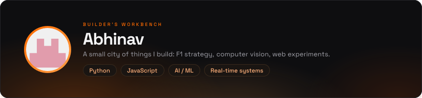

## 01 / The skyline

## 02 / Project district

## 03 / Control room

<h2>04 / The toolbox</h2>

**🧠 Languages**

**🌐 Frameworks & Libraries**

<em>✏️ The tools you reach for, in a sentence.</em>

**🗄️ Databases & DevOps**

<h2 align="center">🫩 My Contributions</h2>

🫩 My Contributions

