```aura width=860 height=200 link="https://github.com/abhinav4001"
<div style={{
  width: '100%', height: '100%', background: '#0E0E10',
  display: 'flex', alignItems: 'center', fontFamily: 'SpaceGrotesk',
  position: 'relative', overflow: 'hidden', borderRadius: 16,
  border: '1px solid #26262A'
}}>

  <style>{`
      @keyframes drift-a {
        0%, 100% { transform: translate(0px, 0px); opacity: 0.55; }
        50% { transform: translate(46px, -16px); opacity: 0.9; }
      }
      @keyframes drift-b {
        0%, 100% { transform: translate(0px, 0px); opacity: 0.45; }
        50% { transform: translate(-34px, 14px); opacity: 0.75; }
      }
      @keyframes drift-c {
        0%, 100% { transform: translate(0px, 0px); opacity: 0.35; }
        50% { transform: translate(-20px, -10px); opacity: 0.6; }
      }
      #warm-1 { animation: drift-a 14s ease-in-out infinite; }
      #warm-2 { animation: drift-b 18s ease-in-out infinite; }
      #warm-3 { animation: drift-c 16s ease-in-out infinite; }
    `}</style>

  <svg width="860" height="200" style={{ position: 'absolute', top: 0, left: 0 }}>
    <defs>
      <radialGradient id="w1" cx="50%" cy="50%" r="50%">
        <stop offset="0%" stopColor="rgba(255,106,0,0.26)" />
        <stop offset="55%" stopColor="rgba(255,106,0,0.10)" />
        <stop offset="100%" stopColor="rgba(255,106,0,0)" />
      </radialGradient>
      <radialGradient id="w2" cx="50%" cy="50%" r="50%">
        <stop offset="0%" stopColor="rgba(255,158,69,0.20)" />
        <stop offset="60%" stopColor="rgba(255,158,69,0.07)" />
        <stop offset="100%" stopColor="rgba(255,158,69,0)" />
      </radialGradient>
      <radialGradient id="w3" cx="50%" cy="50%" r="50%">
        <stop offset="0%" stopColor="rgba(179,61,0,0.18)" />
        <stop offset="100%" stopColor="rgba(179,61,0,0)" />
      </radialGradient>
    </defs>

    <ellipse id="warm-1" cx="150" cy="215" rx="310" ry="150" fill="url(#w1)" />
    <ellipse id="warm-2" cx="470" cy="235" rx="250" ry="120" fill="url(#w2)" />
    <ellipse id="warm-3" cx="810" cy="200" rx="190" ry="110" fill="url(#w3)" />
  </svg>

  <div style={{
    position: 'absolute', left: 48, top: 52, width: 96, height: 96,
    borderRadius: 48, background: 'linear-gradient(135deg, #FF6A00, #FF9E45)',
    display: 'flex', alignItems: 'center', justifyContent: 'center',
  }}>
    
  </div>

  <div style={{ display:'flex', flexDirection:'column', marginLeft:168, gap:6 }}>
    <div style={{ display:'flex', fontFamily:'SpaceGroteskMedium', fontSize:9.5, color:'#FF6A00', letterSpacing:'3px' }}>
      BUILDER'S WORKBENCH
    </div>
    <div style={{ display:'flex', fontFamily:'SpaceGroteskBold', fontSize:34, color:'#F4F4F5', letterSpacing:'-1.1px', lineHeight:1 }}>
      {github?.user?.name || 'Abhinav'}
    </div>
    <div style={{ display:'flex', fontSize:13.5, color:'#A0A0A8', letterSpacing:'0.1px' }}>
      A small city of things I build: F1 strategy, computer vision, web experiments.
    </div>
    <div style={{ display:'flex', gap:8, marginTop:6, flexWrap: 'wrap' }}>
      {['Python', 'JavaScript', 'AI / ML', 'Real-time systems'].map(function(tag, i) {
        return (
          <div key={tag + '-' + i} style={{
            display:'flex', padding:'4px 12px', borderRadius:20,
            background:'#1A1512', border:'1px solid #3A2A1C',
            color:'#FFB07A', fontSize:12, fontFamily:'SpaceGroteskMedium',
          }}>{tag}</div>
        );
      })}
    </div>
  </div>
</div>
```

## 01 / The skyline



## 02 / Project district

```aura width=860 height=320
<div style={{ width:'100%', height:'100%', display:'flex', flexDirection:'column', gap:10, fontFamily:'SpaceGrotesk' }}>
  {[
    { name:'PITWALL', desc:'Real-time F1 strategy co-pilot: live telemetry, Monte Carlo pit windows, sub-second answers.', meta:'Python' },
    { name:'overcomplicator', desc:'A browser experiment that takes a simple idea and overcomplicates it, on purpose.', meta:'JavaScript' },
    { name:'realtime-traffic-sign-board-detection', desc:'Computer-vision pipeline that detects traffic signs from a live video feed.', meta:'Python' }
  ].map(function(p) {
    return (
      <div key={p.name} style={{
        display:'flex', flexDirection:'row', alignItems:'center', gap:16,
        padding:'0 20px', height:92, boxSizing:'border-box',
        background:'#131316', border:'1px solid #26262A', borderRadius:14
      }}>
        <div style={{ display:'flex', width:3, height:40, borderRadius:2, background:'linear-gradient(180deg,#FF6A00,#FF9E45)' }} />
        <div style={{ display:'flex', flexDirection:'column', gap:6, flexGrow:1 }}>
          <div style={{ display:'flex', fontFamily:'SpaceGroteskBold', fontSize:16, color:'#F4F4F5', letterSpacing:'-0.2px' }}>{p.name}</div>
          <div style={{ display:'flex', fontSize:12.5, color:'#A0A0A8' }}>{p.desc}</div>
        </div>
        <div style={{
          display:'flex', padding:'4px 10px', borderRadius:20,
          background:'#1A1512', border:'1px solid #3A2A1C',
          fontSize:10.5, fontFamily:'SpaceGroteskMedium', color:'#FFB07A'
        }}>{p.meta}</div>
      </div>
    );
  })}
</div>
```

## 03 / Control room

```aura width=860 height=104
<div style={{
  width:'100%', height:'100%', display:'flex', alignItems:'center',
  padding:'0 8px', boxSizing:'border-box', fontFamily:'SpaceGrotesk',
  background:'#0E0E10', borderRadius:14, border:'1px solid #26262A'
}}>
  {[
    { label:'REPOSITORIES', value: String(github?.stats?.totalRepos ?? 0), accent:false },
    { label:'STARS EARNED', value: String(github?.stats?.totalStars ?? 0), accent:false },
    { label:'FOLLOWERS', value: String(github?.user?.followers ?? 0), accent:false },
    { label:'TOP LANGUAGE', value: (github?.languages && github.languages.length > 0) ? github.languages[0].name : 'Python', accent:true }
  ].map(function(s, i) {
    return (
      <div key={s.label} style={{
        display:'flex', flexDirection:'column', alignItems:'center', justifyContent:'center',
        gap:8, flexGrow:1, borderLeft: i === 0 ? '1px solid transparent' : '1px solid #222226'
      }}>
        <div style={{
          display:'flex', fontFamily:'SpaceGroteskBold', fontSize:24, lineHeight:1, letterSpacing:'-0.5px',
          color: s.accent ? '#FF6A00' : '#F4F4F5'
        }}>{s.value}</div>
        <div style={{ display:'flex', fontSize:9.5, fontFamily:'SpaceGroteskMedium', color:'#71717A', letterSpacing:'1.3px' }}>{s.label}</div>
      </div>
    );
  })}
</div>
```

<h2>04 / The toolbox</h2>

**🧠 Languages**


**🌐 Frameworks & Libraries**


<em>✏️ The tools you reach for, in a sentence.</em>


**🗄️ Databases & DevOps**


<h2 align="center">🫩 My Contributions</h2>

<details>
<summary>🫩 My Contributions</summary>



</details>

```aura width=860 height=76 link="https://github.com/abhinav4001" align=center
<div style={{
  display:'flex', flexDirection:'column', alignItems:'center', justifyContent:'center', gap:9,
  width:'100%', height:'100%', boxSizing:'border-box',
  background:'#0E0E10', border:'1px solid #26262A', borderRadius:16, fontFamily:'SpaceGrotesk'
}}>
  <div style={{ display:'flex', fontFamily:'SpaceGroteskBold', fontSize:18, color:'#F4F4F5', letterSpacing:'-0.4px' }}>
    The next block starts with a conversation.
  </div>
  <div style={{ display:'flex', fontFamily:'SpaceGroteskMedium', fontSize:12, color:'#FF6A00', letterSpacing:'0.3px' }}>
    Say hello on GitHub
  </div>
</div>
```

```aura width=148 height=40 link="https://github.com/abhinav4001" inline align=center
<div style={{
  width:'100%', height:'100%', display:'flex', alignItems:'center', justifyContent:'center'
}}>
  <div style={{
    display:'flex', flexDirection:'row', alignItems:'center', justifyContent:'center', gap:7,
    width:136, height:40, boxSizing:'border-box',
    background:'#131316', border:'1px solid #35271B', borderRadius:20
  }}>
    
    <span style={{ display:'flex', fontFamily:'SpaceGroteskMedium', fontSize:12, color:'#F4F4F5', letterSpacing:'0.1px' }}>abhinav4001</span>
  </div>
</div>
```

```aura width=148 height=40 link="https://github.com/abhinav4001/PITWALL" inline align=center
<div style={{
  width:'100%', height:'100%', display:'flex', alignItems:'center', justifyContent:'center'
}}>
  <div style={{
    display:'flex', flexDirection:'row', alignItems:'center', justifyContent:'center', gap:7,
    width:136, height:40, boxSizing:'border-box',
    background:'#131316', border:'1px solid #35271B', borderRadius:20
  }}>
    
    <span style={{ display:'flex', fontFamily:'SpaceGroteskMedium', fontSize:12, color:'#F4F4F5', letterSpacing:'0.1px' }}>PITWALL</span>
  </div>
</div>
```

```aura width=148 height=40 link="https://overcomplicator.vercel.app" inline align=center
<div style={{
  width:'100%', height:'100%', display:'flex', alignItems:'center', justifyContent:'center'
}}>
  <div style={{
    display:'flex', flexDirection:'row', alignItems:'center', justifyContent:'center', gap:7,
    width:136, height:40, boxSizing:'border-box',
    background:'#131316', border:'1px solid #35271B', borderRadius:20
  }}>
    
    <span style={{ display:'flex', fontFamily:'SpaceGroteskMedium', fontSize:12, color:'#F4F4F5', letterSpacing:'0.1px' }}>Live site</span>
  </div>
</div>
```

```aura width=860 height=22 link="https://github.com/collectioneur/readme-aura"
  <div style={{ display: 'flex', justifyContent: 'center', alignItems: 'center', width: '100%', height: '100%', padding: 0, margin: 0 }}>
    <span style={{ fontFamily:'SpaceGrotesk', fontSize: 11, lineHeight: 1, color: '#5B5B63', letterSpacing: '0.4px' }}>city by gitskins · built with readme-aura</span>
  </div>
```
